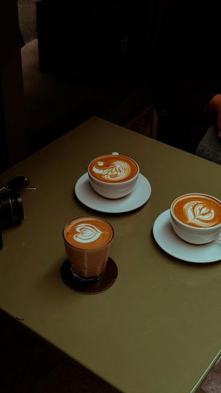
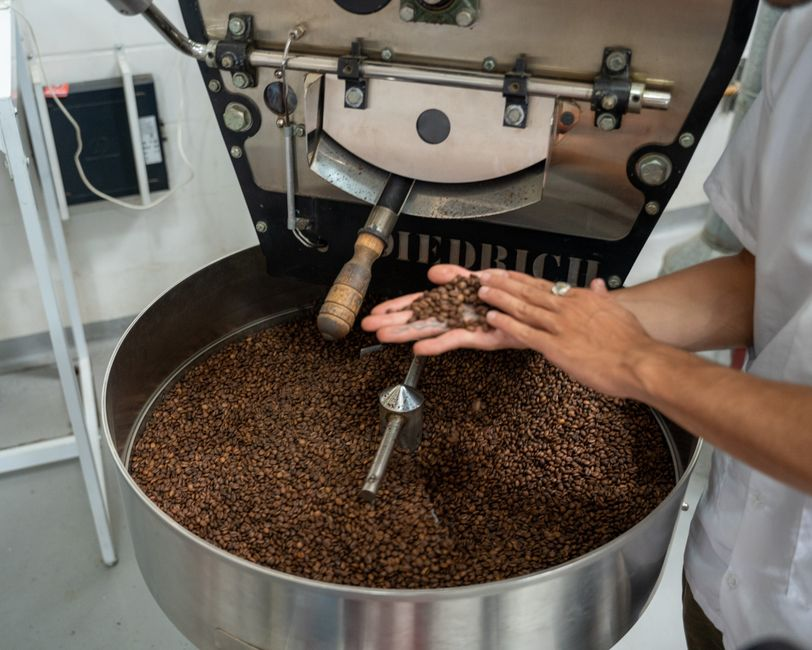
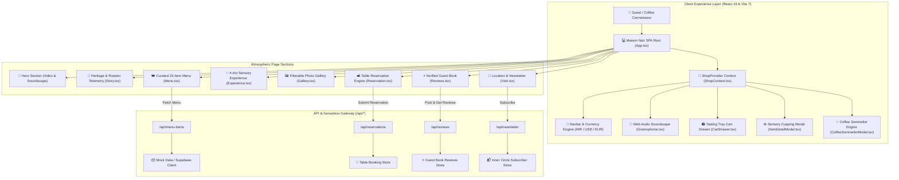

<div align="center">

# ☕ Maison Noir — Luxury Café & Single-Origin Roastery
### *Where Coffee Becomes Ceremony • Haute Specialty Roastery Experience*

**An ultra-luxurious, immersive specialty coffeehouse web platform featuring real-time Web Audio vinyl jazz synthesis, live roaster instrumentation telemetry, interactive sensory flavor sommelier, multi-currency commerce, and tableside reservation rituals.**

[](https://react.dev/)
[](https://www.typescriptlang.org/)
[](https://vitejs.dev/)
[](https://tailwindcss.com/)
[](https://www.framer.com/motion/)
[](https://developer.mozilla.org/en-US/docs/Web/API/Web_Audio_API)
[](https://supabase.com/)
[](LICENSE)

[Features](#-key-features--technical-novelty) • [Application Showcase](#️-application-showcase--ui-tour) • [Architecture](#-system-architecture) • [Setup Guide](#-step-by-step-implementation--setup-guide) • [How to Use](#-how-to-use--interactive-workflows) • [Project Structure](#-project-structure) • [Tech Stack](#️-tech-stack) • [Verification](#-verification--testing) • [Contributing](#-contributing) • [License](#-license)

</div>

---

## 📖 Overview

**Maison Noir** is an haute-couture digital sanctuary crafted for a world-class single-origin coffeehouse and roastery founded in 1998. Designed to elevate the digital presence of third-wave specialty coffee into Michelin-caliber luxury dining, the platform replaces ordinary transactional café menus with sensory storytelling, unhurried rituals, and multi-sensory interactions.

Built on **React 19**, **TypeScript**, **Tailwind CSS v4**, and **Vite 7**, Maison Noir blends tactile motion design powered by **Framer Motion** with client-side **Web Audio API** synthesis. Visitors are immersed in the atmosphere of the grand salon: listening to vintage vinyl crackle and warm acoustic jazz pad harmonies that stream seamlessly and endlessly without external media buffering, while exploring live drum roaster sensor readouts, cupping dials, and bespoke tableside reservation booking.

Whether selecting a rare Panama Geisha vacuum siphon brew, calculating customized roast and body profiles through the interactive **Coffee Sommelier Dial**, or ordering a direct-trade tasting tray with edible 24k gold leaf flakes, Maison Noir exemplifies state-of-the-art web performance, accessible dark-gold typography, and responsive micro-interactions across desktop and mobile devices.

---

## ✨ Key Features & Technical Novelty

### 🎛️ 1. Live Drum Roaster Telemetry & Global Bean Atlas
- **Live Sensor Telemetry:** Real-time simulated sensor dials for a vintage 1928 Probat cast-iron drum roaster, tracking **Drum Temperature (`208.4°C`)**, **Laminar Air Flow (`84%`)**, **Batch Identification (`#MN-892`)**, and a live **Dawn Freshness Clock** calculating time elapsed since sunrise roasting.
- **Global Origin Atlas:** Deep-dive cards displaying single-origin estate altitudes (*e.g., 2,200m ASL Yirgacheffe*), micro-lot processing methods (*Anaerobic Natural, Honey Process, Wet-Hulled*), cupping notes, and verified **92+ SCA Cupping Scores**.
- **Interactive Rate-of-Rise (RoR) Curve:** Vector SVG visualizer charting Dry End, First Crack, and Drop milestones across the thermal roasting curve.

### 🧭 2. Interactive Coffee Sommelier & Sensory Profiler
- **Interactive Cupping Dials:** Sliders and toggles for **Roast Profile** (*Light/Medium/Dark*), **Dominant Aromatics** (*Jasmine & Peach, Saffron, Dark Truffle, Bourbon Vanilla*), **Body & Extraction Intensity (1-5 Meter)**, and **Setting/Mood** (*Morning Dawn, Afternoon Focus, Evening Vinyl Lounge*).
- **Algorithmic Match Engine:** Evaluates sensory inputs in real-time to recommend bespoke Maison Noir cups with matching percentage, pairing rationale, and 1-click **Add to Tasting Tray**.

### 🎵 3. Pure Web Audio Synthesizer & Rotating Clockwise Gramophone
- **Zero-Dependency Acoustic Audio:** Custom Web Audio API synthesizer generating genuine 1960s vinyl groove hiss, micro-pops, warm acoustic low-pass filtering, and an endless 7-chord cyclic jazz progression (*Cmaj9 $\rightarrow$ Am9 $\rightarrow$ Dm9 $\rightarrow$ G13 $\rightarrow$ Fmaj7#11 $\rightarrow$ Em7 $\rightarrow$ A7alt*).
- **Direct Autoplay & Gesture Unlock:** Starts playing immediately on website entry with automatic fallback unlock on the first subtle user gesture.
- **Rotating Antique Gramophone:** Artisanal SVG brass gramophone with a fluted acoustic horn and gold-accented turntable disc that rotates clockwise continuously ($360^\circ$ infinite linear spin) while audio streams.

### 📜 4. Curated 23-Item Fine Dining Menu with Cupping Radar
- **4 Signature Categories:** *Espresso Extractions (5 items)*, *Signature Brews (6 items)*, *Cold & Iced (6 items)*, and *Patisserie & Confections (6 items)*.
- **100% Unique Photography:** Every offering features its own distinct high-resolution image, cupping radar meters (*Roast Level, Acidity, Sweetness, Body, Aroma Complexity*), temperature options (*Hot, Iced, Tableside Siphon*), organic milk choices, and edible 24k gold leaf flakes.
- **Dietary & Quality Filters:** Instant filtering by *Direct-Trade Only, Vegan-Friendly, and Gluten-Free*.

### 💱 5. Global Multi-Currency Engine with Indian Rupees (INR - ₹)
- **Real-Time Currency Switching:** Native selector situated at the top right supporting **INR (`₹`)**, **USD (`$`)**, **EUR (`€`)**, **GBP (`£`)**, **JPY (`¥`)**, and **AED (`د.إ`)**.
- **Synchronized Pricing:** Instantly recalculates all menu items, tasting journeys, gift boxes, gratuity, and checkout summaries without page reload.

### 🛍️ 6. Slide-Over Tasting Tray Order Management & Checkout Simulation
- **Flexible Service Modes:** Choose between **Dine-In Tableside Delivery** (*with table number input*) and **Roastery Takeaway Pickup**.
- **Luxury Add-ons:** Toggle *Maison Noir Wax-Sealed Brass Gift Tin*, select barista gratuity (15% to 25%), and receive a generated order ticket pass (`#MN-ORD-xxxxx`).

### 🛋️ 7. Full-Featured Table Reservation System
- **Atmosphere & Seating Zones:** Select from *The Velvet Salon*, *The Slow Bar*, *The Cellar Lounge (Vinyl Room)*, or *The Courtyard Garden*.
- **VIP Ritual Enhancements:** Optional *Tableside Siphon Masterclass* and *Chef's Pastry Flight*.
- **Booking Utilities:** Instant copyable reservation pass and downloadable **iCalendar (`.ics`)** file.

### 🖼️ 8. Ascending Section Scroll Glow & Interactive Media Gallery
- **Ascending Scroll Highlighting:** Smooth scroll-spy lighting up nav links (*Story $\rightarrow$ Menu $\rightarrow$ Experience $\rightarrow$ Gallery $\rightarrow$ Reviews $\rightarrow$ Visit*) in gold aura radiance.
- **Fullscreen Gallery Lightbox:** Filterable by Salon, Barista Art, Slow Bar, and Patisserie with keyboard arrow navigation.

---

## 🖼️ Application Showcase & UI Tour

<div align="center">

### 👑 The Grand Hero & Atmospheric Ambient Video

> **Atmospheric Hero**: Looping high-definition barista video backdrop with gold typography, live roaster badge, and rotating gramophone soundscape toggle.

---

### ☕ Artisanal Menu & Sensory Radar Dials

> **Sensory Cupping Radar**: Interactive modal displaying origin altitude, harvest lot, and quantitative meters for Acidity, Body, Sweetness, and Aroma.

---

### 🎛️ Live 1928 Probat Roaster Telemetry

> **Roasting Room Telemetry**: Live sensor telemetry dials for Drum Temperature (`208.4°C`), Air Velocity (`84%`), and Rate-of-Rise (RoR) curve.

---

### 🥐 Dawn Baked Patisserie & Slow Bar Rituals

> **Chef's Signatures**: Hand-laminated Valrhona croissants, pistachio rose tarts, and tableside siphon infusions.

</div>

---

## 🏗️ System Architecture



---

## 🚀 Step-by-Step Implementation & Setup Guide

### Step 1: Prerequisites
Ensure your local development environment has the following installed:
- **Node.js**: `v18.0.0` or higher (`v20+` recommended)
- **npm**: `v9.0.0` or higher
- **Git**: Latest version

### Step 2: Clone Repository
```bash
git clone https://github.com/SriniwasAwasthi/maison-noir-luxury-coffee.git
cd maison-noir-luxury-coffee
```

### Step 3: Environment Configuration
Create a `.env` file in the root directory:
```bash
cp .env.example .env
```
Ensure the environment keys are configured (fallback memory mode runs automatically if Supabase is offline):
```env
NEXT_PUBLIC_SUPABASE_URL=https://your-project.supabase.co
NEXT_PUBLIC_SUPABASE_ANON_KEY=your-anon-key
SUPABASE_SERVICE_ROLE_KEY=your-service-role-key
VITE_SUPABASE_URL=https://your-project.supabase.co
VITE_SUPABASE_ANON_KEY=your-anon-key
```

### Step 4: Install Dependencies
```bash
npm install
```

### Step 5: Launch Development Server
```bash
npm run dev
```
Open your browser and navigate to **`http://localhost:5173/`**.

### Step 6: Production Build & Preview
To create an optimized production build:
```bash
npm run build
npm run preview
```

---

## 💡 How to Use & Interactive Workflows

1. **Ambient Soundscape:** On loading the page, the vinyl jazz audio automatically starts. Click the **Rotating Gramophone** in the bottom-right corner to toggle soundscapes (*Vintage Vinyl Jazz, Roastery Slow Bar, Rain on Stained Glass*) or adjust master volume.
2. **Currency Switching:** Select **INR (₹)**, **USD ($)**, **EUR (€)**, **GBP (£)**, **JPY (¥)**, or **AED (د.إ)** in the top right header. All prices update dynamically across every section.
3. **Ascending Scroll Tracking:** Scroll through the site to observe the navbar highlight smoothly glow in ascending order (*Story $\rightarrow$ Menu $\rightarrow$ Experience $\rightarrow$ Gallery $\rightarrow$ Reviews $\rightarrow$ Visit*).
4. **Interactive Sommelier:** Click **"Flavor Sommelier"** in the navigation or hero to complete the 4-step sensory quiz and receive an instant single-origin match.
5. **Cupping Dial & Customization:** Click any menu item card to inspect its cupping radar (*Acidity, Body, Sweetness, Aroma*), choose milk & extraction style, add **24k Gold Leaf Flakes**, and add to your Tasting Tray.
6. **Table Reservation:** Navigate to the Reservation section, choose your preferred ambiance zone (*Velvet Salon, Slow Bar, Cellar Lounge, Courtyard*), select tableside siphon masterclasses, and download your **iCalendar (.ics)** booking pass.

---

## 📂 Project Structure

```
maison-noir-luxury-coffee/
├── api/                                # Serverless & Dev API handlers
│   ├── db-client.js                    # Safe Supabase client with fallback
│   ├── db-wake.js                      # Database wake trigger utility
│   ├── menu-items.js                   # Menu filtering and querying API
│   ├── mock-data.js                    # 23 unique menu items & sensory cupping profiles
│   ├── newsletter.js                   # Inner Circle email subscription API
│   ├── reservations.js                 # Table booking and pass generation API
│   └── reviews.js                      # Guest book submission and retrieval API
├── public/                             # Public static assets
│   ├── favicon.svg                     # Maison Noir gold monogram favicon
│   ├── images/                         # 23 100% unique high-res coffee & pastry images
│   │   ├── brew-chemex.jpg             # Authentic Chemex hourglass pour over
│   │   ├── brew-siphon.jpg             # Japanese vacuum siphon extraction
│   │   ├── espresso-reserve.jpg        # Single-origin Ethiopian espresso
│   │   ├── cold-kyoto-drip.jpg         # 24-hour slow drip cold brew
│   │   └── pastry-chocolate-croissant.jpg # 72-layer laminated chocolate croissant
│   └── videos/
│       └── hero.mp4                    # Atmospheric ambient barista background video
├── src/                                # Frontend Source Code
│   ├── assets/                         # SVG icons and logos
│   ├── components/                     # Modular React Components
│   │   ├── AudioBar.tsx                # Floating soundscape widget with rotating gramophone
│   │   ├── CartDrawer.tsx              # Slide-over tasting tray & checkout modal
│   │   ├── CoffeeSommelierModal.tsx    # Interactive 4-step coffee cupping quiz
│   │   ├── Experience.tsx              # 4-Act sensory tasting journey
│   │   ├── Gallery.tsx                 # Filterable photo gallery with fullscreen lightbox
│   │   ├── Gramophone.tsx              # Clockwise rotating antique brass gramophone
│   │   ├── Hero.tsx                    # Video hero with gold typography & CTA dials
│   │   ├── ItemDetailModal.tsx         # Sensory cupping radar & ingredient customizer
│   │   ├── Menu.tsx                    # 23-item menu with live search & dietary filters
│   │   ├── Navbar.tsx                  # Ascending scroll spy & currency selector
│   │   ├── Reservation.tsx             # Table reservation engine & .ics calendar exporter
│   │   ├── Reviews.tsx                 # Guest book carousel & live review writer
│   │   ├── RoasterTelemetry.tsx        # Live 1928 Probat sensor & bean atlas widget
│   │   ├── Story.tsx                   # Heritage narrative & craft statistics
│   │   └── Visit.tsx                   # OpenStreetMap dark view & newsletter signup
│   ├── context/
│   │   └── ShopContext.tsx             # Currency converter, cart, and audio state provider
│   ├── utils/
│   │   └── audio.ts                    # Pure Web Audio API continuous jazz synth engine
│   ├── App.tsx                         # Main Application Container
│   ├── index.css                       # Tailwind CSS v4 theme, fonts, and gold aura effects
│   └── main.tsx                        # React 19 DOM Entrypoint
├── .env                                # Local environment variables
├── eslint.config.js                    # ESLint 9 configuration
├── index.html                          # HTML template with metadata & fonts
├── package.json                        # Project dependencies & scripts
├── tsconfig.json                       # TypeScript compiler configuration
├── vercel.json                         # Vercel deployment configuration
└── vite.config.ts                      # Vite 7 configuration with custom API dev middleware
```

---

## 🛠️ Tech Stack

### Client & Framework
- **[React 19](https://react.dev/)**: Modern component architecture with optimistic updates.
- **[TypeScript](https://www.typescriptlang.org/)**: Full strict type-safety across all components, APIs, and contexts.
- **[Vite 7](https://vitejs.dev/)**: Next-generation frontend tooling with instant HMR and custom API connect middleware.

### Styling & Motion
- **[Tailwind CSS v4](https://tailwindcss.com/)**: CSS-first design tokens with custom `@theme` noir, espresso, and antique gold variables.
- **[Framer Motion](https://www.framer.com/motion/)**: GPU-accelerated layout transitions, slide-over panels, and spring animations.
- **[Lucide React](https://lucide.dev/)**: Clean, accessible iconography.

### Audio & Sensory Engine
- **[Web Audio API](https://developer.mozilla.org/en-US/docs/Web/API/Web_Audio_API)**: Oscillator banks, biquad low-pass filtering, white noise vinyl crackle synthesis, and infinite jazz chord arpeggiation.

### Persistence & APIs
- **[Supabase JS Client](https://supabase.com/)**: Optional cloud PostgreSQL integration with seamless in-memory fallback.

---

## 🧪 Verification & Testing

Verify that all builds, TypeScript type checks, and lint standards pass without error:

```bash
# Execute TypeScript strict type checking & production compilation
npm run build

# Run ESLint validation
npm run lint

# Test dev server API endpoints & health status
node -e "fetch('http://localhost:5173/api/menu-items').then(r => r.json()).then(d => console.log('Items Count:', d.length))"
```

---

## 🤝 Contributing

Contributions, issues, and feature requests are warmly welcomed!
1. **Fork** the Repository.
2. **Create** your Feature Branch (`git checkout -b feature/sensory-brew-timer`).
3. **Commit** your Changes (`git commit -m 'feat: add interactive extraction timer'`).
4. **Push** to the Branch (`git push origin feature/sensory-brew-timer`).
5. **Open** a Pull Request.

---

## 📄 License

This project is open-sourced under the **MIT License** — see the [LICENSE](LICENSE) file for full details.

---

## 💖 Thank You for Exploring Maison Noir!

> *"Coffee is not merely an extraction of beans; it is an unhurried ceremony of aroma, temperature, and craft."*

If you enjoyed exploring **Maison Noir**, please consider giving this repository a ⭐ **Star** on GitHub!

### 📬 Connect with the Developer:
- 🌐 **LinkedIn:** [sriniwas-awasthi](https://www.linkedin.com/in/sriniwas-awasthi/)
- 💻 **GitHub:** [@SriniwasAwasthi](https://github.com/SriniwasAwasthi)
- 📧 **Email:** [sriawasthi164@gmail.com](mailto:sriawasthi164@gmail.com)

<div align="center">
  <sub>Crafted with passion by <b>Sriniwas Awasthi</b> • Powered by Google Gemini AI</sub>
</div>
